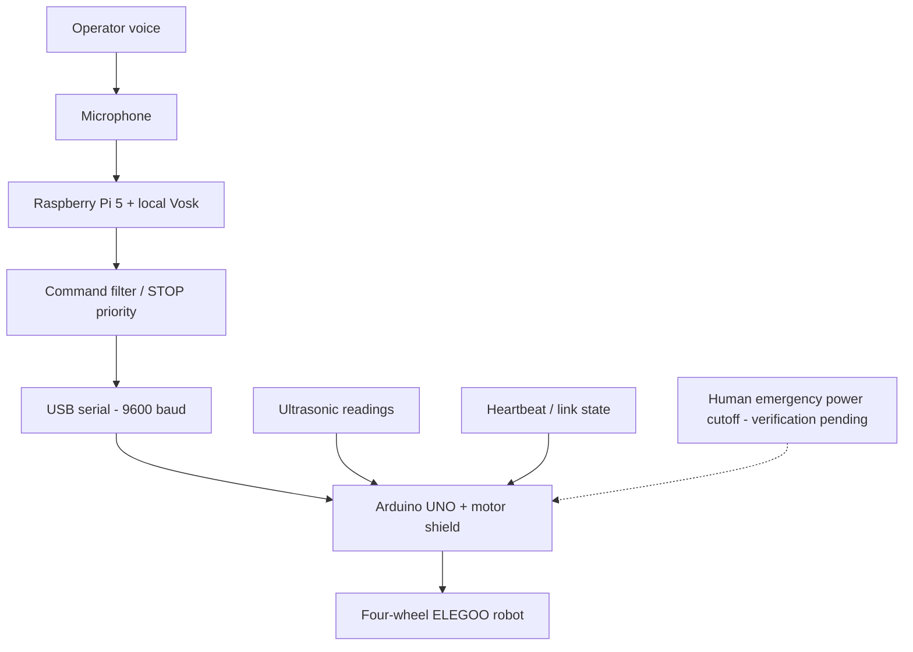

# Byte Bots — Voice-Controlled Robotic Mobility

**A scaled, offline-capable mobility-control proof of concept**  
**Course:** ITAI 4376 — AI Controls for Robotics (Fall 2026)  
**Team:** Oscar Cortez and Andrew Kuruvilla  
**Technology:** Raspberry Pi 5 · Vosk · Python · Arduino UNO · ELEGOO Smart Robot Car V4.0 · USB serial  
**Stage:** Physical floor trials documented in November 2026; formal safety acceptance incomplete

> **Scope and safety:** Byte Bots is an educational four-wheel robot. It is **not** a powered wheelchair, passenger-carrying mobility device, certified safety controller, or product ready for use around people.

## The problem

A traditional joystick is not ideal for everyone with limited hand mobility. We wanted to explore a focused question: can an inexpensive, locally running speech recognizer turn a small set of voice commands into useful robotic motion, without relying on cloud speech services, while giving the operator a clear STOP command and a path to safer control?

We deliberately used a **small ELEGOO robot** rather than attempting a human-size mobility device. This let our team learn about real hardware integration, control latency, power problems, communications failures, and the gap between a working demonstration and a safety-validated system.

## What we built

The control concept takes voice input through a microphone, runs Vosk speech recognition locally on a Raspberry Pi 5, filters a five-command vocabulary, and communicates with an Arduino UNO through USB serial. The Arduino and motor shield drive the four-wheel robot. We also investigated ultrasonic distance checks, heartbeat messages, arm/disarm states, and STOP behavior.

The five design commands were **forward, backward, left, right, STOP**. Not every command has been independently validated through the same final end-to-end powered test.

**Why offline operation matters:** Recognition runs on the Pi, not in the cloud. During later trials, Oscar accessed the Pi directly from his HP laptop through the Pi's **local wireless connection**, without depending on an external Wi-Fi network or internet. That does **not** mean the Pi radio was powered off: it supplied the local connection. SSH allowed the laptop to access the system; it was not a cloud speech-recognition service.

## How we tested it

The project progressed from troubleshooting communication and software on the bench to moving the scaled robot on the floor. Oscar conducted the hands-on floor trials. The instructor authorized project testing, but test authorization does not equal formal product or safety acceptance.

| When | Activity and observed evidence | What it does **not** establish |
|---|---|---|
| **Oct. 30–31** | Rebuilt Raspberry Pi-to-Arduino communication over CH340 USB serial at 9600 baud. Verified replies and short **forward, backward, left, and right** motor actions with wheels elevated, followed by stops. | Floor-driving quality, measured stopping distance, or emergency-stop certification. |
| **Nov. 4** | Controlled single-speaker voice-recognition experiment improved from **33/100** to **100/100** by adding a short “SPEAK NOW” delay before speaking five single-word commands. | Final speech-to-wheel success, multiple users, noisy-room robustness, or final phrase grammar acceptance. |
| **Nov. 6** | Serial STOP returned `{BB_ok}`; interruption of heartbeat messaging produced `LINK_LOST`, followed by rejected commands in `DISARMED` state. Ultrasonic trial placements produced BLOCK/ALLOW outputs. | Actual moving-wheel stop time, independent power-cutoff performance, or calibrated sensing. |
| **Later November** | **Seven recorded floor-trial clips** show physical robot motion in different sessions. Oscar tested battery and external-cord power arrangements and external-network versus local laptop-to-Pi connectivity. | A fully controlled factorial test matrix, independently logged network status, or proven voice-command-to-wheel causation in every clip. |

### Different power and network conditions

We explored **both battery power and a power-cord workaround**, and **both use of an external network and a direct local laptop-to-Pi connection**.

- **Externally connected session:** source recordings `7227` and `7226`.
- **Local-link session (no external network/internet):** `7081`, `7080`, `7079`, `7077`, `7076`. The external power cord is visible in these clips.
- The clip groupings and power conditions come from Oscar's test notes. The raw video does not independently record Wi-Fi settings or identify the power source for every frame.
- A power cord solved a testing problem but introduced a snag hazard. It is **not** the intended mobility design.

Recorded footage exists in the team's review materials. It is not embedded here while external distribution of media is being checked.

## The engineering problems that mattered

### 1. The serial link was harder than expected

Early Raspberry Pi serial reads returned no meaningful replies, and the Arduino shield and UART configuration caused confusion. We checked the CH340 adapter, serial speed, firmware upload, command format, and interface path. Using the **Pi → USB serial → Arduino** path consistently was important: an earlier Raspberry Pi direct-GPIO motor example was not interchangeable with the ELEGOO shield interface. During recovery, an Arduino library-version conflict also required troubleshooting.

### 2. A speech-recognition score needs context

Our initial voice-recognition test captured only **33 out of 100** expected single-word inputs. After changing the start-of-recording timing and adding a cue, the experiment achieved **100/100** in that controlled test. That improvement was meaningful, but we do not present it as 100% recognition in unrestricted rooms or as the result for the final moving controller.

### 3. Software STOP is not a physical E-stop

We demonstrated serial acknowledgments and a loss-of-link/disarmed state. Those are necessary pieces of control software, not the same thing as proving a powered robot stops within a measured time. We did not finish the complete moving-STOP and independent motor-cutoff acceptance matrix.

### 4. Sensor readings can be misleading

A close object sometimes produced a distance reading that the provisional logic interpreted as clear. Better-aligned tests produced BLOCK, but the mismatch remained a safety finding. A repeatable number is not necessarily an accurate number.

### 5. Practical operation revealed power and network assumptions

Our floor trials explored operation both on battery power and with an external power cord, and access both through an external network and through the Pi's direct local connection. The local connection reduced reliance on institutional/home Wi-Fi. The cord assisted troubleshooting but created a new hazard and showed why robust battery power is part of the engineering problem.

## Safety limits and what remains open

This scaled prototype has **not** passed a formal human-mobility safety review. In particular, our available evidence does not establish:

- Measured voice-command-to-wheel latency under the final integrated configuration.
- Twenty verified moving STOP trials within the original target.
- Ten independently observed motor-power-cutoff stops.
- Measured motor-side communication-loss stopping within 500 ms.
- Fully calibrated ultrasonic coverage for every direction of movement.
- Controlled endurance, repeatability, and recovery/fault testing across all original blueprint scenarios.

The November 6 record also documents **unexpected wheel movement during motor-battery disconnection**. We treated that as an unresolved safety incident. We would not extrapolate this classroom robot to passenger transport or claim safe operation near bystanders based on video alone.

## What we would improve next

1. **Stabilize battery power:** eliminate the temporary external tether and document power isolation clearly.
2. **Instrument the demo:** log recognized phrases, serial requests/replies, Arduino state, power configuration, and synchronized motor video.
3. **Complete repeatable safety tests:** verify a truly independent cutoff; measure STOP time, watchdog/link-loss behavior, stale-command rejection, recovery, and false positive commands.
4. **Calibrate the ultrasonic sensor:** test real distances, alignment angles, materials, and sensor failure modes before using clearance as a motion gate.
5. **Freeze a reproducible build:** recovered source is now archived, but still confirm the deployed Python/Arduino versions, Vosk model, operating system, wiring, tested dependencies, and matching demonstration logs.

## What we learned

The hardest part was not installing a speech-recognition library. It was **integrating several imperfect components** into a physical robot and separating observations from assumptions. A console message, a motor spinning with wheels raised, and a successful floor run each answer different engineering questions. We learned why a real prototype needs both functional demonstrations and explicit evidence boundaries.

The result is a useful **education and portfolio prototype**, not a finished assistive mobility product.

## Team and provenance

- **Oscar Cortez:** project manager; safety, risk, documentation; Raspberry Pi/Arduino hardware recovery and hands-on bench/floor tests; laptop-to-Pi local connection and power-condition trials.
- **Andrew Kuruvilla:** Byte Bots team member responsible for the software and voice-control integration workstream. Specific code authorship should be attributed using the final team log rather than assumed here.
- **Anthony Randall:** earlier mechanical assembly and integration work before leaving the team.

Vosk and ELEGOO firmware are third-party technologies. The team's contribution is the integration, testing, troubleshooting, and engineering documentation; we do not claim authorship of those external components.

### Recovered controller code (November 22, 2026)

We recovered the original V6 and V7 Raspberry Pi Python controllers and the V7 patch script directly from the Byte Bots Pi and archived copies in [the recovered source folder](source/README.md). We also recovered and archived the [full Arduino V2 / November 10 ACKFIX package](firmware/README.md), including the sketch and supporting source files plus a separate V6.1 companion Python controller. The Arduino sketch's checksum matches the Milestone 5 record. **The ACKFIX package itself was marked uncompiled/unflashed/untested when prepared, and the running firmware/version at the later floor trials remains unverified.** Recovery alone does not prove a frozen, fully reproducible end-to-end system or close formal safety-test gaps.

### Related documentation

- [Byte Bots milestone index](Byte_Bots_Milestone_Index.md)
- [October 30–31 hardware recovery log](Byte_Bots_Hardware_Test_Log_2026-10-30_31.md)
- [ELEGOO Smart Robot Car firmware repository](https://github.com/elegooofficial/ELEGOO-Smart-Robot-Car-Kit-V4.0-New)
- [Vosk offline speech recognition](https://alphacephei.com/vosk/)
- [Separate electric mobility scooter digital-twin project](../../README.md)

*Updated November 22, 2026. The results above describe a prototype with incomplete formal acceptance; they should not be interpreted as certified mobility-device performance.*
